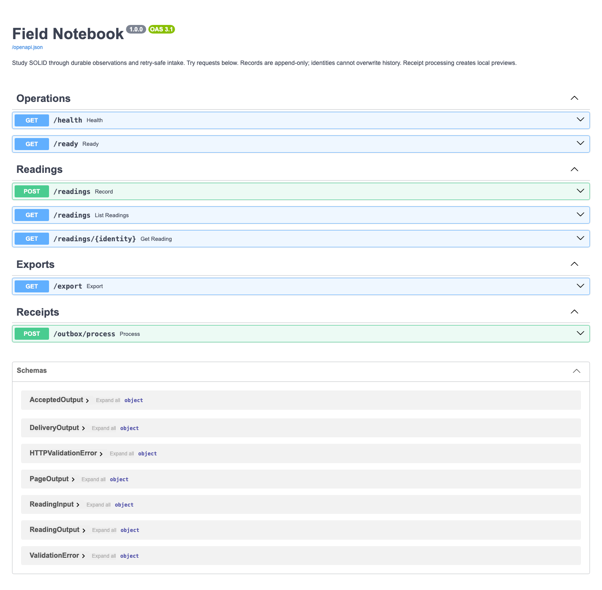

# Field Notebook · SOLID with Python

A working research-reading backend and a study path through five design decisions. Start with small command-line examples, explore failure and compatibility labs, then follow the same ideas into a FastAPI application with SQLite persistence.

Record observations, replay a request safely, browse bounded pages, export a page and process durable receipt intent. The backend exposes interactive API documentation at `/docs`; it creates local receipt previews, not emails.



Actual Chromium capture of the local API documentation.

## Run the application

Use **Python 3.11 or newer**. Check your interpreter version first; some macOS installations still default to an older Python.

```bash
python3 -m venv .venv
source .venv/bin/activate
python -m pip install -r requirements-dev.txt
PYTHONPATH=src python -m solid_workbook.backend --database data/notebook.sqlite3
```

Open [the API workbench](http://127.0.0.1:8000/docs). The command binds to localhost. The database is created on first run and survives server restarts. Use `--memory` instead of `--database` for an ephemeral comparison with the same API contracts. Runtime dependencies are pinned in [requirements.txt](requirements.txt); development checks are pinned separately.

```bash
curl -i http://127.0.0.1:8000/readings \
  -H 'Content-Type: application/json' \
  -H 'Idempotency-Key: ridge-001' \
  -d '{"identity":"ridge-001","station":"North ridge","kelvin":281.25}'

curl 'http://127.0.0.1:8000/readings?limit=10'
curl 'http://127.0.0.1:8000/export?format=json&limit=10'
curl -X POST http://127.0.0.1:8000/outbox/process
```

The first intake returns **201**. Repeat the same key/content for **200 replayed**; change the intent under that key or reuse a reading identity under a new key for **409 conflict**. Invalid input returns **422**. A storage acknowledgement failure returns **503 unconfirmed**, so retry using the same identity, key and content. Acceptance and receipt processing are separate operations.

## Choose a study route

- New to Python: [Python orientation](docs/PYTHON_START.md), then the first foundation.
- Studying SOLID: [learning path](docs/LEARNING_PATH.md), examples, exercises and separate solutions.
- Preparing senior-level discussions: [architecture](docs/ARCHITECTURE.md), [backend walkthrough](docs/BACKEND.md), [decision records](docs/decisions/README.md) and [interview rehearsal](docs/INTERVIEW_PREP.md).

| Principle | Foundation | Reliable behaviour | Backend/system study |
| --- | --- | --- | --- |
| SRP | [Field notebook](lessons/1-srp/README.md) | [Recovery lab](lessons/1-srp/feature/README.md) | [Ownership and intake](lessons/1-srp/system/README.md) |
| OCP | [Export bench](lessons/2-ocp/README.md) | [Version compatibility](lessons/2-ocp/feature/README.md) | [Export strategies](lessons/2-ocp/system/README.md) |
| LSP | [Archive shelf](lessons/3-lsp/README.md) | [Catalogue contracts](lessons/3-lsp/feature/README.md) | [Interchangeable repositories](lessons/3-lsp/system/README.md) |
| ISP | [Station board](lessons/4-isp/README.md) | [Read-only backend consumers](lessons/4-isp/system/README.md) | [Consumer-owned ports](lessons/4-isp/system/README.md) |
| DIP | [Publication desk](lessons/5-dip/README.md) | [Uncertain processing outcomes](lessons/5-dip/system/README.md) | [Composition and durable intent](lessons/5-dip/system/README.md) |

## Verify

```bash
ruff check .
ruff format --check .
mypy
PYTHONPATH=src python -m unittest discover -s tests
python scripts/check_docs.py
python scripts/smoke_backend.py
PYTHONPATH=src python -m solid_workbook all
PYTHONPATH=src python -m solid_workbook srp-lab
PYTHONPATH=src python -m solid_workbook ocp-lab
PYTHONPATH=src python -m solid_workbook lsp-lab
```

**138 tests** cover the small examples, recovery/compatibility/catalogue labs, the same memory/SQLite repository contracts, real SQLite rollback and concurrency, persistent retry state and the same HTTP workflows with both adapters. Strict mypy checks source contracts; Ruff enforces formatting and lint. CI repeats checks on Python 3.11 and 3.12. The documentation checker validates local inline link targets, excluding external URLs and heading fragments.

## Scope and useful tradeoffs

This is a complete local reference workflow for learning backend design. Observations are immutable and append-only. Reading, key binding and receipt intent commit together. Preview delivery is separately idempotent in the bundled sink; this does not prove exactly-once delivery to an external service.

This application has no user accounts, public deployment, background scheduler, queue leases, dead-letter policy or backup automation. Processing is explicit, one event per request. Pages and fields are bounded, but raw HTTP body size is not capped by this application. Cursor paging is append-only traversal, not a fixed multi-request database snapshot. These boundaries are discussed in the decisions rather than hidden behind interfaces.

Compare the same questions in [Swift](https://github.com/aguamonkey/SOLID-Principles-with-Swift), [TypeScript](https://github.com/aguamonkey/solid-principles-typescript) and [Rust](https://github.com/aguamonkey/solid-principles-rust). Each language has its own application setting and implementation choices.

[Contributing](CONTRIBUTING.md) · [MIT licence](LICENSE)
