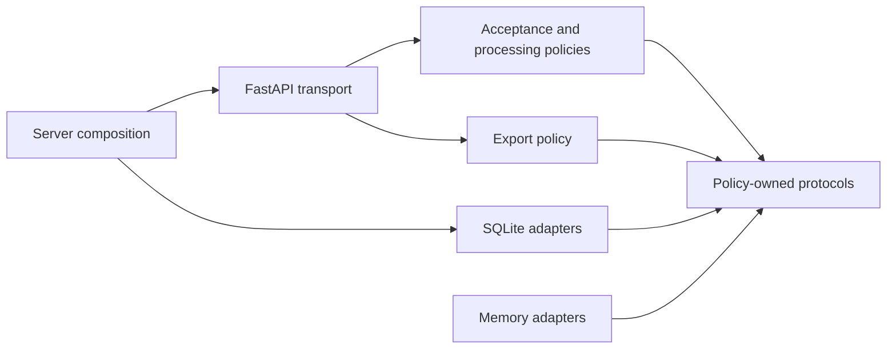

# Architecture · follow the promises

[Repository](../README.md) · [Backend](BACKEND.md) · [Decisions](decisions/README.md)

The application keeps HTTP and persistence outside the use-case contracts. The small lessons remain separate executable references; the backend connects their reasoning in one practical workflow.

## Walk one request

[http.py](../src/solid_workbook/backend/http.py) validates the HTTP shape with strict Pydantic models. [domain.py](../src/solid_workbook/backend/domain.py) establishes valid, immutable observations independently of the framework. [policy.py](../src/solid_workbook/backend/policy.py) selects use-case behaviour through [ports.py](../src/solid_workbook/backend/ports.py). [sqlite_store.py](../src/solid_workbook/backend/sqlite_store.py) fulfils atomic acceptance and durable receipt contracts. Response models map the confirmed result back to HTTP.

The domain reuses the foundation’s finite/nonnegative reading invariant. HTTP errors and SQL are not imported into policy. [Server composition](../src/solid_workbook/backend/__main__.py) chooses a concrete store and receipt sink explicitly. Importing the package does not open a database or start a server.

## Responsibility and evidence

| Concern | Owner | Evidence |
| --- | --- | --- |
| HTTP shape, status and correlation | `http.py` | API validation, replay, conflict, error sanitisation tests |
| Observation invariants | `domain.py` | Shared value domain and canonical numeric replay |
| Record/key/outbox transaction | `ReadingWriter` implementation | SQLite trigger rollback and concurrent same-key tests |
| Bounded ordered reads | `ReadingReader` implementation | The same contract cases against memory and SQLite |
| New export behaviour | Registered renderer | Test-only renderer through unchanged export policy |
| Processing and uncertainty | `process_receipt` | No send on empty/failed queue; no ack on sink failure |
| Idempotent local effect | `ReceiptSink` implementation | Same event replay, conflict, lost ack/restart and concurrent processing |

## Python choices

Frozen dataclasses express value objects. They prevent ordinary field reassignment, not deliberate bypass. Protocols allow structurally compatible fixtures without forced inheritance; runtime decoding and behavioural tests remain separate requirements. The HTTP reader composes lookup and paging. The exporter requests only paging. The queue keeps both related processing operations together: consumer needs determine cohesion.

SQLite is synchronous, so storage endpoints use normal `def` functions. FastAPI runs those endpoints in a thread pool; merely changing them to `async def` would not make blocking SQLite calls asynchronous. See the [official concurrency guidance](https://fastapi.tiangolo.com/async/).

Each SQLite operation owns a connection on its calling thread and closes it explicitly. Writes use explicit `BEGIN IMMEDIATE`, `COMMIT` and rollback with foreign keys enabled. We use the transaction primitives available on Python 3.11 as well as 3.12; see [Python’s SQLite documentation](https://docs.python.org/3.11/library/sqlite3.html). This avoids depending on an ORM to conceal the teaching boundary.

Memory uses locks and immutable projections. SQLite uses database uniqueness and transaction serialisation. Their implementations differ while their externally tested promises stay the same. Neither is a drop-in implementation of the catalogue lab’s *fixed snapshot* protocol: live repository reads may include later appends.

## Limits that shape another design

A SQLite file and a five-second busy timeout suit a local reference application. They do not establish multi-region availability or high-write throughput. Key bindings have no retention/expiry policy. Request field/page sizes are bounded; raw HTTP bodies are not capped. There is no authenticated tenant boundary, network sender or autonomous retry worker. Each is a concrete additional requirement that would change contracts or composition, not proof that the current code violates SOLID.
